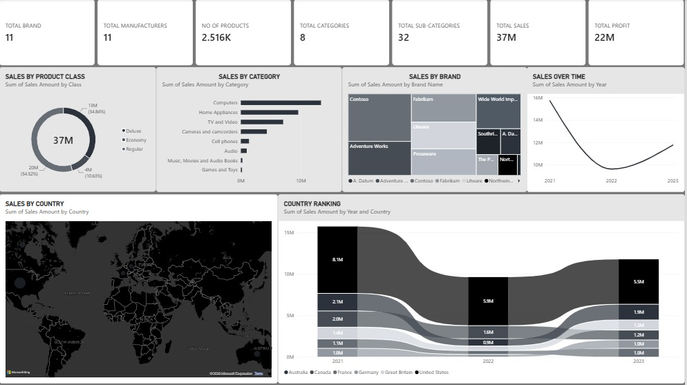

# Executive Sales Performance Dashboard (Power BI)

## 📌 Project Overview
An end-to-end interactive Power BI dashboard designed to analyze key sales metrics, identify high-performing product categories and brands, and track historical revenue trends across regions.

---

## 📊 Dashboard Preview

---

## 🔑 Key Features & Analysis
* **KPI Metrics:** Executive overview tracking Total Brands, Manufacturers, Products, Categories, Sales Revenue ($37M), and Profit ($22M).
* **Sales by Product Class:** Donut visual illustrating revenue breakdown across Deluxe, Economy, and Regular tiers.
* **Sales by Category:** Sorted bar chart highlighting top-grossing categories (led by Computers and Home Appliances).
* **Brand Analysis:** Treemap displaying proportional sales distributions across global brands.
* **Country Rankings (Ribbon Chart):** Dynamic ranking visualization tracking annual movement and revenue rank shifts (2021–2023).
* **Geographic Mapping:** Dark-themed spatial map detailing state-level sales density.

---

## 🛠️ Tools & Technologies Used
* **Business Intelligence:** Power BI Desktop
* **Data Modeling:** DAX, Star Schema Relationships
* **UI/UX:** Custom Slate Grey Design System (Palette 2)
